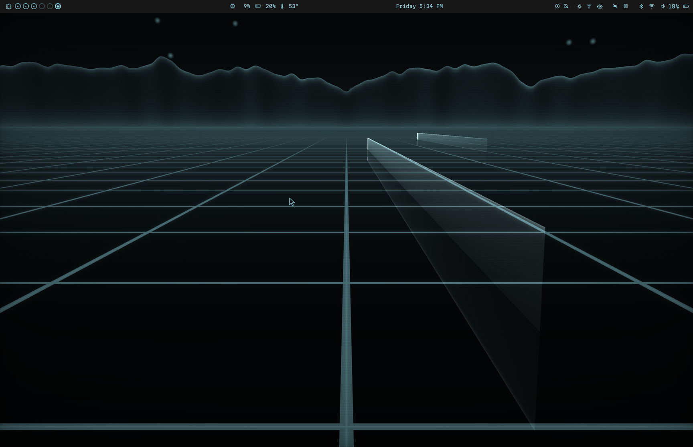
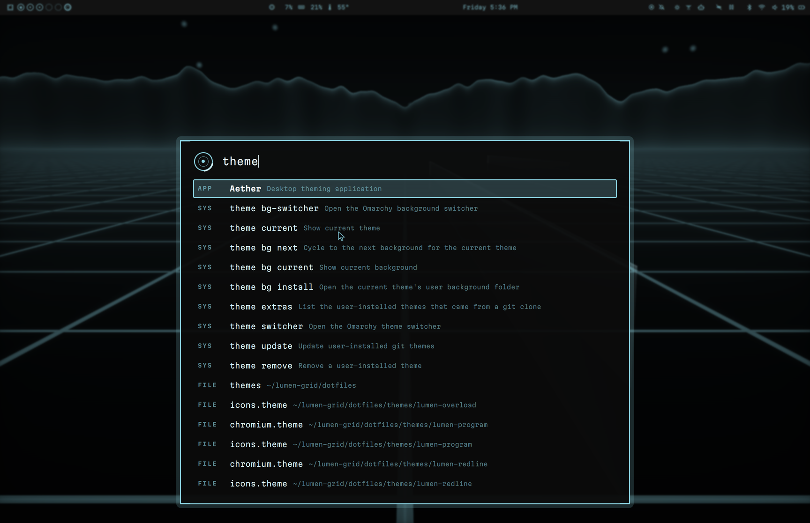
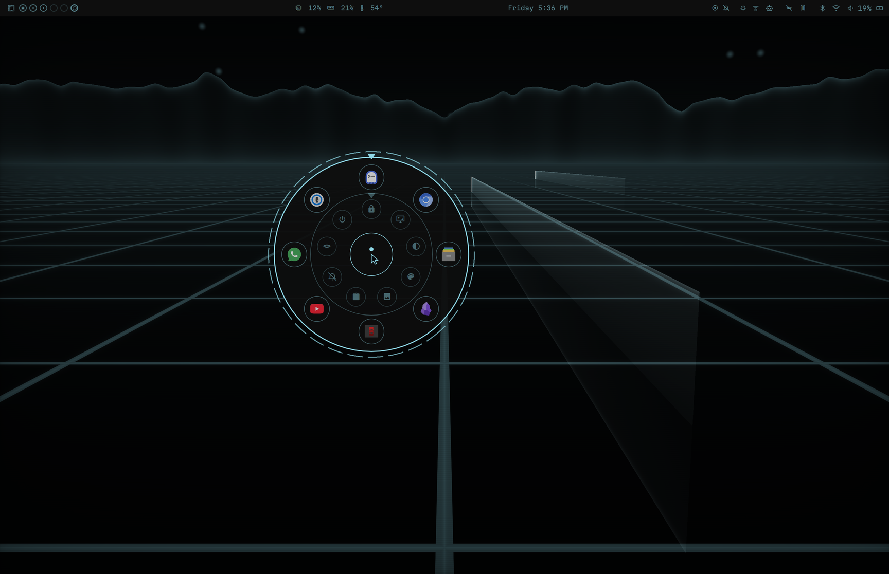
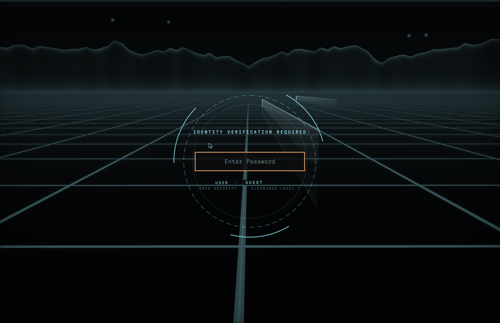
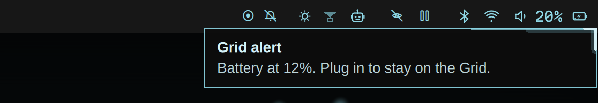
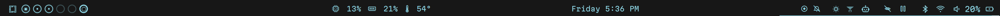

# Lumen Grid

A neon-grid, sci-fi desktop for [Omarchy](https://omarchy.org) (Arch + Hyprland): a live 3D grid
world as your wallpaper, light-cycle effects on windows and workspaces, a security-checkpoint lock
screen, a command bar that understands plain English, a light-disc app launcher, and a bar redrawn
in thin light-line icons. Everything follows the active theme, and the three themes switch the whole
system at once:

- **Program**: cool cyan, the everyday look
- **Overload**: amber, turns on by itself while a root shell is open (`sudo -i`, `sudo su`, ...)
- **Redline**: red, the grid alert for low battery, overheating or a broken update



| Computer bar (`SUPER+SPACE`) | Light-disc launcher (hold `SUPER+D`) |
|---|---|
|  |  |
| **Lock screen** | **Notifications** |
|  |  |



## Features

**The desktop**
- Live 3D grid wallpaper: an endless reflective grid, light cycles trailing light walls, a glowing
  mountain range, drifting particles. It pulses with music and CPU load, and a bar button pauses it.
- Window effects: windows break into glowing cells when they close, are scanned in as a wireframe
  when they open, and flicker in like a hologram when they get focus.
- Workspaces slide left and right; `SUPER+TAB` is a held card switcher (current workspace squeezes
  back, the next comes to the center, release `SUPER` to zoom in).
- "Systems online" boot-up HUD on wake and unlock; edge light surges when you plug in power or
  connect Wi-Fi / Bluetooth; two light discs duel over the grid when you're idle; sentinels patrol
  during the screensaver.

**Lock screen**: a security checkpoint over the live grid: scan beam, rotating rings,
ACCESS DENIED glitch on a wrong password, ACCESS GRANTED burst on the right one.

**Launchers**
- Computer bar (`SUPER+SPACE`): live search across apps, Omarchy commands and files; type a web
  address to open it; end with `?` to ask the computer in plain English (uses the Claude Code CLI;
  safe Omarchy commands run directly, anything else needs a second Enter).
- Light-disc launcher (hold `SUPER+D`, point, let go): apps on the outer ring, quick actions inside.

**The bar**: every icon redrawn as a thin light-line glyph (one size, one color), CPU / memory /
temperature readout in the middle (flanking the notch on a MacBook), status icons only when
something is on, a Claude Code activity icon, voice glow while dictating, and buttons for the live
wallpaper and grid vision (tint the whole screen to the theme color while chosen apps are focused).

**Everywhere else**: light-line cursors, translucent folder icons, GTK apps (Files and friends) in
the theme colors, see-through system apps, notification cards with a light beam riding their edge,
a HUD shell prompt, and Ghostty with a light-cycle cursor trail, display glow and single-color text.

**Browser** (Chromium/Chrome extension): video focus mode, a dark theme on every site, and a
themed YouTube.

**Hardware touches** (when the machine has them): the keyboard backlight breathes while Claude Code
is waiting for you and flashes on notifications.

## Keys

| Keys | What |
|---|---|
| `SUPER+SPACE` | Computer bar (search; end with `?` to ask). Omarchy's menu moves to `SUPER+ALT+C` |
| hold `SUPER+D` | Light-disc launcher |
| `SUPER+TAB` / `SUPER+SHIFT+TAB` | Card switcher |
| `SUPER+ALT+T` | Switch Program / Overload |
| `SUPER+ALT+V` | Grid vision on / off |

## Requirements

- Omarchy (tested on 4.0.3), logged in at least once
- Optional: [Claude Code](https://claude.com/claude-code) for the `?` questions and the activity icon;
  Voxtype (`omarchy voxtype install`) for the voice glow

The installer adds the packages it needs (Ghostty, Martian Mono Nerd Font, Papirus icons, fd, ...)
through `omarchy pkg add`.

## Install

```bash
git clone https://github.com/ln-bodicherla/lumen-grid.git
cd lumen-grid
./install.sh            # asks before the optional parts; --yes accepts them all, --no-apply skips applying
```

It shows what it will change and asks before starting. Everything it touches is backed up to
`~/.local/state/lumen-grid/backup-<time>/`. It's safe to re-run, and you should re-run it after
Omarchy updates (it re-applies its patches to Omarchy's notifications, launcher, clock and lock
screen, and falls back to Omarchy's own if a patch no longer fits).

By hand, if you want them:
- Browser extension: `chrome://extensions` → Developer mode → Load unpacked → the repo folder
- Ghostty as the default terminal: `omarchy install terminal ghostty`
- Boot splash: `omarchy plymouth set-by-theme lumen-program`

## Uninstall

```bash
./uninstall.sh
```

Removes everything and restores your previous bar, theme, font and config files.

## Customizing

- Disc launcher apps and actions: `~/.config/omarchy/lumen-disc.json` (format at the top of
  `dotfiles/plugins/lumen-fx/Disc.qml`)
- Grid vision apps: the eye icon in the bar
- Theme colors: `dotfiles/themes/lumen-*/colors.toml`, then re-run `./install.sh`

## How it works

- `dotfiles/plugins/lumen-fx/`: a Quickshell plugin for the Omarchy shell (wallpaper, effects,
  launchers, switcher); GLSL shaders in `shaders/`, compiled with `qsb` at install time
- `dotfiles/plugins/{notifications,menu,clock,lock}/`: small patches applied to fresh clones of
  Omarchy's own plugins
- `dotfiles/bar-modules/`: custom bar widgets
- `dotfiles/bin/`: helper commands and the background services
- `os/`: generators for the icon font, cursors, folder icons, wallpapers, GTK and terminal colors
- Browser extension: the repo root (`manifest.json`, `content.*`, `youtube.css`, `popup.*`)

## Credits

- [Omarchy](https://github.com/basecamp/omarchy) (MIT): the shell plugins this patches
- [libraries.dev](https://libraries.dev) (MIT): inspiration for the border beam, orb and gooey effects
- [Papirus icon theme](https://github.com/PapirusDevelopmentTeam/papirus-icon-theme) (GPL-3.0): the
  folder icons are generated from it on your machine; none are shipped here
- [Martian Mono](https://github.com/evilmartians/mono) (OFL-1.1) via Nerd Fonts: the icon font is a
  patched copy built on your machine; none is shipped here
- [OmDrop](https://github.com/brentkearney/omdrop-plugin): optional, installed from its own repo

## Disclaimer

Lumen Grid is a fan-made, Tron-inspired theme. It is not affiliated with, endorsed by or connected
to Disney or the TRON franchise. All imagery in this repository is generated by its own code.

## License

[MIT](LICENSE)
